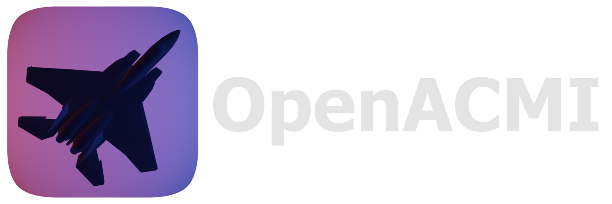
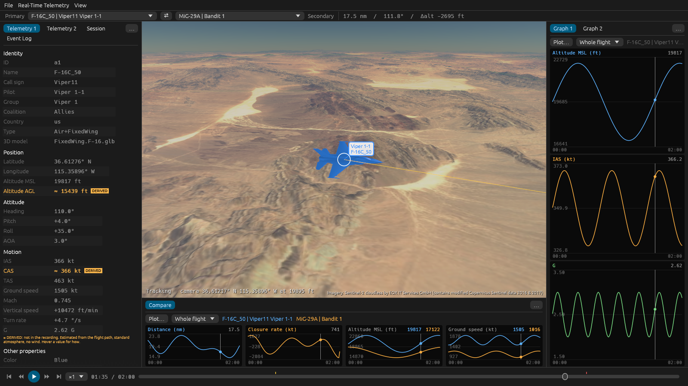

# OpenACMI


**Free, open-source ACMI flight recording viewer and real-time telemetry monitor.**

> A community-built alternative to Tacview - replay your flights, analyse engagements, and monitor live telemetry from any simulator or data source that speaks the ACMI 2.x protocol.



---

## Why OpenACMI?

[Tacview](https://www.tacview.net/) is excellent software - but it's closed-source, expensive at the Advanced tier, and gives you little control over how your data is processed or displayed. OpenACMI aims to change that.

- **Free, forever.** No subscriptions, no feature tiers.
- **Open source.** Understand exactly what happens to your data. Extend it, fork it, contribute back.
- **Full ACMI 2.x support.** Any simulator that can export to Tacview can be viewed in OpenACMI - DCS World, Falcon BMS, IL-2, X-Plane, MSFS, and more.
- **Real-time streaming.** Connect directly to a live telemetry server and watch engagements unfold as they happen.
- **Native and fast.** Written in Rust on [wgpu](https://wgpu.rs/) and [egui](https://www.egui.rs/): a single executable, no runtime to install, and recordings load without throwing data away.

---

## Download

Get the latest Windows build from the [**Releases page**](https://github.com/Spearhead2/OpenACMI/releases/latest), unzip it anywhere and run `OpenACMI.exe`. Keep the `assets` folder next to the executable.

Then **File › Open** an `.acmi` file (plain or zipped), or drop one onto the window. A small synthetic recording is included as `samples/demo.acmi`.

You need a GPU with DirectX 12, Vulkan or Metal. Terrain and satellite imagery are streamed from the internet the first time you look at a place and kept on disk afterwards; everything else works offline.

Linux and macOS are not packaged yet. The code is meant to be portable, but so far it has only been built and tested on Windows - see [Building from source](#building-from-source) if you want to try.

---

## Features

### 3D globe
- The whole Earth with country borders and a latitude / longitude grid, accurate at any scale from orbit down to a few metres from an aircraft
- **Streamed 3D terrain** from real elevation data, including land below sea level such as the Dead Sea
- **Satellite imagery** draped over the terrain, or a choice of elevation colour schemes (natural, atlas, arid, greyscale, dark)
- A physically based atmosphere: sky, haze with distance, and red light near the terminator
- The sun where it really was at the recording's date and time

### Recordings
- Full ACMI 2.x parser: every object type, every documented property, kept as a time series
- Plain `.acmi`, zipped `.acmi`, and `.zip.acmi` detected from the file's contents
- Lossless loading by default, **Save As** that round-trips everything, and CSV export of an object's telemetry
- Delta-state handling, line continuations and recycled object ids

### Real-time telemetry
- Connects to any Tacview-compatible real-time telemetry server, including the password handshake
- Live data can be scrubbed, paused and saved like a recording

### Objects and trails
- 3D models chosen automatically from each object's name and type, in `.glb` or `.obj`, coloured by coalition
- **Ribbon trails** for aircraft and helicopters: a band in the plane of the wings, dark on top and light underneath, so rolls are visible at a glance
- Line trails for everything else, with altitude lines dropped to the ground
- Labels that never overlap, and objects that stay visible from any distance

### Analysis
- **Telemetry panels** for a primary and a secondary object: position, attitude, speeds, Mach, G, AOA, turn rate and every other recorded property
- **Graphs** of any of those against time, for each object
- A **comparison graph** that overlays both objects and plots what relates them: distance, closure rate, bearing to target and altitude difference
- **Derived data** where a recording lacks it - IAS, CAS, TAS, Mach, G and AOA are estimated from the flight path and standard atmosphere, and always clearly marked `DERIVED`
- Event log with jump-to-event, and marks on the timeline

### Interface
- Every panel can be **docked** to the left, right, top or bottom of the 3D view, or undocked into a floating window
- Four camera modes: global orbit, tracking, cockpit and free flight
- **Right-click an object** to edit its identity or choose a different 3D model
- A Preferences window for everything else; the window, its panels and all settings are remembered between runs

---

## 3D models

OpenACMI ships with simple generic shapes only. To see real aircraft:

1. Get a set of models named the way Tacview names them, for example `FixedWing.F-16.glb` or `Vehicle.Tank.T-72.obj`. The [Tacview community model library](https://github.com/Vyrtuoz/Tacview) is the usual source; it is GPL v3 licensed and is **not** part of OpenACMI - see that repository for its terms.
2. Put them in a folder, or in a `meshes` folder inside one.
3. Choose that folder with **File › 3D Model Folder…**

The Telemetry panel shows which model file each object is drawn with, and the 3D view tells you when no models of your own were found. You can also right-click any object and pick a model for it by hand.

---

## Controls

| Input | Action |
|---|---|
| Left / right drag | Orbit (global, tracking), look around (cockpit, free flight) |
| Wheel, `+` / `-` | Zoom; in free flight, change speed |
| `W A S D`, arrows | Orbit / fly; `Q` `E` down / up in free flight; `Shift` = faster |
| Click an object | Select as primary (`Ctrl` / `Shift` + click: secondary) |
| Right-click an object | Menu: edit object, select as primary or secondary |
| Click the globe | Show the coordinates under the pointer |
| Click or drag in a graph | Move playback to that moment |
| Middle drag | Scrub through time |
| `Shift` + right drag | Move the sun |
| `Space` | Play / pause |
| `,` `.` | Previous / next sample of the primary object |
| `Home` `End` | Start / end of the recording |
| `C` | Cycle camera mode |
| `Ctrl+O`, `Ctrl+S` | Open, save as |

---

## Supported simulators

Anything that writes ACMI 2.x files or speaks the real-time telemetry protocol:

| Simulator | Export method |
|---|---|
| DCS World | Tacview exporter (DCS2ACMI) |
| Falcon BMS | Built-in ACMI export |
| IL-2 Sturmovik | Built-in ACMI export |
| X-Plane | Tacview plugin |
| MSFS / FSX | Tacview plugin |
| Any source | Any server speaking the real-time telemetry protocol |

If a recording from your simulator does not load or looks wrong, please open an issue and attach it.

---

## Building from source

You need a recent stable [Rust toolchain](https://rustup.rs/).

```bash
git clone https://github.com/Spearhead2/OpenACMI.git
cd OpenACMI
cargo run --release -p openacmi -- samples/demo.acmi
```

```bash
cargo test --workspace
```

The project is a workspace of five crates, each with one job:

| Crate | Responsibility |
|---|---|
| `acmi-core` | Data model, ACMI parser and writer, geodesy, derived flight data. No I/O. |
| `acmi-io` | Loading and saving files, the real-time telemetry client. |
| `acmi-terrain` | Streams, caches and decodes terrain and imagery tiles. No GPU code. |
| `acmi-render` | The wgpu renderer: globe, terrain, atmosphere, models, trails. Knows nothing about recordings or the UI. |
| `openacmi` | The application: UI, camera, timeline, settings. |

[docs/DEVELOPMENT.md](docs/DEVELOPMENT.md) explains how the pieces fit together and how to add a quantity, a panel, a colour scheme or a setting.

---

## Roadmap

- [x] Windows release build
- [x] Export of object telemetry to .csv
- [x] Charting of object telemetry
- [x] Save live data to file
- [x] Event log
- [x] Tile map support - streamed satellite imagery and terrain from any XYZ tile provider
- [x] File editing - object identity and 3D model
- [ ] Linux and macOS release builds
- [ ] Support for flat-world, non-real terrains for sims like Nuclear Option
- [ ] Enhanced 2D plan view
- [ ] Display of radar locks
- [ ] Weapons employment log and shot analysis
- [ ] Localization
- [ ] Use local game terrain heightmaps for enhanced 3D visualization
- [ ] Multi-session overlay (compare two recordings)
- [ ] Plugin API for custom data sources
- [ ] Database XML support (Tacview-compatible object definitions)
- [ ] Screenshot / video export
- [ ] Connection to ADS-B data
- [ ] Multiplayer debrief mode (shared session over LAN)
- [ ] Multiplayer live controller mode (custom display for live feeds)
- [ ] `*.oacm` (OpenACMI File Pack) for more functionality
- [ ] More file editing (adding objects, changing parameters)
- [ ] Attachment of cockpit display recordings to the recording (part of the `*.oacm` file)

Have another idea? Post it in an issue!

---

## Contributing

Contributions of all kinds are welcome - code, bug reports, simulator-specific testing, documentation.

- Bugs and ideas go in the [issue tracker](https://github.com/Spearhead2/OpenACMI/issues). A recording that reproduces the problem helps more than anything else.
- For code, start with [docs/DEVELOPMENT.md](docs/DEVELOPMENT.md). Please run `cargo test --workspace` and `cargo clippy --workspace --all-targets` before opening a pull request.

---

## License

MIT License - see [LICENSE](LICENSE) for details.

You are free to use, modify, and distribute OpenACMI for any purpose, including commercial applications.

---

## Acknowledgements and data sources

- [Tacview](https://www.tacview.net/) by Frantz 'Vyrtuoz' Raia - for the inspiration and the ACMI format specification that makes this possible.
- The Falcon BMS, DCS World, and IL-2 communities - for years of ACMI tooling, exporters, and feedback.
- [Natural Earth](https://www.naturalearthdata.com/) - country border data.
- Terrain elevation: [Terrain Tiles](https://registry.opendata.aws/terrain-tiles/) hosted on AWS, originally by Mapzen, built from SRTM, GMTED, ETOPO1 and other open sources.
- Satellite imagery: [Sentinel-2 cloudless](https://s2maps.eu) by [EOX IT Services GmbH](https://eox.at) (contains modified Copernicus Sentinel data 2016 & 2017), CC BY 4.0. Imagery is streamed from EOX's servers; if you use it heavily, please point OpenACMI at your own tile server in Preferences.
- The Rust graphics community, in particular [wgpu](https://wgpu.rs/) and [egui](https://www.egui.rs/).

---

*OpenACMI is an independent open-source project and is not affiliated with Tacview or RaiaSoftware.*  
*© Amir "Spearhead" Levy & Contributors*
